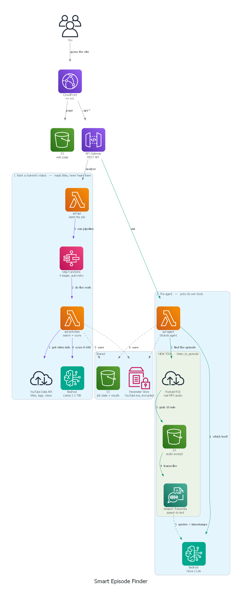

# Smart Episode Finder

**Ranks YouTube videos. Listens to podcast episodes.**

Long-form content is hard to choose. A channel holds hundreds of uploads and a
podcast episode can run two hours, and the title rarely tells you whether it covers
the thing you care about. Smart Episode Finder scores videos against your interests,
and for podcasts it transcribes the real audio so it can tell you what was actually
said.

🔗 **Live app: https://dad3m4gxlizq4.cloudfront.net**

Fully serverless on AWS — nothing runs when the app is idle, roughly **$0–1/month**
of infrastructure.

---

## Features

### Channel video ranking

Give it a YouTube channel name and a plain-English description of your interests.

- **Searches inside one channel** rather than across all of YouTube, so you don't
  scroll through hundreds of uploads
- **Keeps long-form videos only** — anything under 10 minutes is filtered out
- **Scores every video 0–100** for relevance, sorted best first, with a one-line
  reason for each score
- **Uses all available signals** — title, description, tags, chapters parsed from
  description timestamps, duration, view/like/comment counts
- **Channel summary** describing the channel's focus and format
- **3–5 key insights** about recurring themes and discussion depth
- **Content tone** classified as educational, entertainment, news, tutorial or mixed
- **Live progress** through the four pipeline stages as it runs
- Configurable scan size, 3 to 50 videos

### Podcast episode transcription

An AI agent that fetches and transcribes real episode audio.

- **Resolves a podcast by name** via the iTunes Search API, ranking candidates by
  name match and episode count so ambiguous names resolve to the right show
- **Lists recent episodes** from the show's RSS feed to pick from
- **Transcribes the real audio** with Amazon Transcribe, with automatic language
  identification across English and Hindi variants
- **Choose how much to transcribe** — 5, 10, 20 or 30 minutes
- **Returns what was actually said** — topics, names, products and tools mentioned,
  with direct quotes and timestamps
- **Full timestamped transcript** viewable in the UI
- **Degrades honestly** — if an episode's audio can't be fetched it tries the next
  few episodes, and says so rather than inventing content

### Episode deep dive

Click any ranked video for a detailed breakdown:

- **TL;DR** — a few sentences on the episode's arc
- **Key topics** and **5–7 actionable takeaways**
- **Notable quotes** and an **episode timeline**
- **Tools and resources** mentioned
- **Who should watch** — the ideal audience
- **Provenance banner** stating whether the analysis came from a real transcript or
  from the video's description, so a description summary is never presented as a
  record of what was said

### Throughout

- **Durable execution** — every pipeline step retries automatically with exponential
  backoff on a timeout, rate limit or network error
- **Parallel stages** — interest parsing runs alongside transcript fetching, and
  ranking alongside summarisation
- **Credential redaction** — API keys are stripped from any error before it is logged
  or returned
- **No secrets in code** — the YouTube key lives encrypted in Parameter Store

---

## The agent

Built with the **Strands Agents SDK** on **Amazon Bedrock**. It has two tools and
chooses between them per question rather than following a fixed script:

| Tool | What it reaches |
|---|---|
| `search_podcast_episodes` | YouTube Data API — titles, descriptions, tags, view counts |
| `listen_to_episode` | Real podcast audio, transcribed by Amazon Transcribe |

Two live runs with both tools available:

```
"What did the hosts SAY about AI models?"      → chose  listen_to_episode
"Which DSA episodes exist and their views?"    → chose  search_podcast_episodes
```

Same code, same tools, different decisions — the model reads each tool's description
and picks. For a content question it transcribes; for a catalogue question it reads
metadata and doesn't waste a transcription job.

### How `listen_to_episode` works

YouTube blocks requests from AWS IP ranges, so transcripts can't be fetched from
there. Podcasts, though, are also published as plain MP3 enclosures in RSS feeds,
served by CDNs that don't block datacentre IPs:

```
show name
   │  iTunes Search API              (free, no key needed)
   ▼
podcast RSS feed  →  MP3 enclosure URL
   │  range-GET only the first N minutes
   ▼
Amazon S3  →  Amazon Transcribe  →  timestamped transcript
```

**Partial fetch.** Episodes run to 250 MB. The tool range-GETs only the opening
minutes, which keeps a Transcribe job to seconds rather than twenty minutes and caps
the cost per call. MP3 is frame-based, so a truncated file still decodes.

**The tool reports its own uncertainty.** It returns which show it actually resolved
and whether the requested episode title matched, so the agent can notice a mismatch
and retry rather than confidently describing the wrong audio.

---

## Architecture



Regenerate the diagram with `python serverless/infra/architecture.py` (needs
`diagrams` and Graphviz).

### AWS services

| Service | What it does here |
|---|---|
| **Amazon CloudFront** | HTTPS entry point, free TLS certificate, edge caching |
| **Amazon S3** | Static UI, job state, and episode audio excerpts |
| **Amazon API Gateway** | HTTP API exposing the REST endpoints |
| **AWS Lambda** | All application code, Python 3.12 — three functions |
| **AWS Step Functions** | Durable orchestration with retries and parallel stages |
| **Amazon Bedrock** | Nova 2 Lite drives the agent; Llama 3.3 70B scores and summarises |
| **Amazon Transcribe** | Episode audio to timestamped text |
| **AWS IAM** | Four least-privilege execution roles |
| **AWS Systems Manager Parameter Store** | Encrypted YouTube API key, read at cold start |
| **Amazon CloudWatch Logs** | Logs from every function |

### Deployed resources (us-east-1)

| Type | Name |
|---|---|
| CloudFront | `EPGC4W454TWH0` → `dad3m4gxlizq4.cloudfront.net` |
| S3 | `spf-site-414691912352`, `spf-jobs-414691912352` |
| API Gateway | HTTP API `xcz68za6vg` |
| Lambda | `spf-api`, `spf-activities`, `spf-agent` |
| Step Functions | `spf-insights`, `spf-deepdive` |
| IAM roles | `spf-api-role`, `spf-activities-role`, `spf-sfn-role`, `spf-agent-role` |

Bedrock and Transcribe are reached through IAM execution roles, and the YouTube API
key is resolved from Parameter Store once per cold start — so rotating it needs no
redeploy.

### The ranking pipeline

Step Functions runs four stages, with two pairs running in parallel:

```
Search  ─►  ┌ Parse interests ┐  ─►  ┌ Rank videos ┐  ─►  Finalise
            └ Fetch transcripts┘      └ Summarise   ┘
```

Only a `job_id` flows between states; the working set lives in S3.


---

## Local development

```bash
cd serverless
pip install -r requirements.txt strands-agents==1.45.0

# resolve the YouTube key from Parameter Store instead of hardcoding it
set YOUTUBE_API_KEY_PARAM=/smart-podcast-finder/youtube_api_key

python -m agent.demo
```

Needs AWS credentials with Bedrock, Transcribe, S3 and SSM access.

## Deploying changes

```powershell
cd serverless

# Lambda code
.\build.ps1
python build-agent.py
aws lambda update-function-code --function-name spf-api        --zip-file fileb://build/api.zip        --region us-east-1
aws lambda update-function-code --function-name spf-activities --zip-file fileb://build/activities.zip --region us-east-1
aws lambda update-function-code --function-name spf-agent      --zip-file fileb://build/agent.zip      --region us-east-1

# the UI
python build-site.py
python build/deploy_site.py     # uploads, invalidates CloudFront, waits for it to go live
```

Rotate the YouTube API key without redeploying:

```powershell
aws ssm put-parameter --name /smart-podcast-finder/youtube_api_key `
  --type SecureString --value "AIza..." --overwrite --region us-east-1
```

---


## Cost

| | |
|---|---|
| Infrastructure | ~$0–1/month, within the Lambda, Step Functions and CloudFront free tiers |
| Bedrock | ~$0.72 per million tokens, roughly $0.005 per analysis |
| Transcribe | ~$0.024 per minute — about $0.24 for a 10-minute excerpt |
